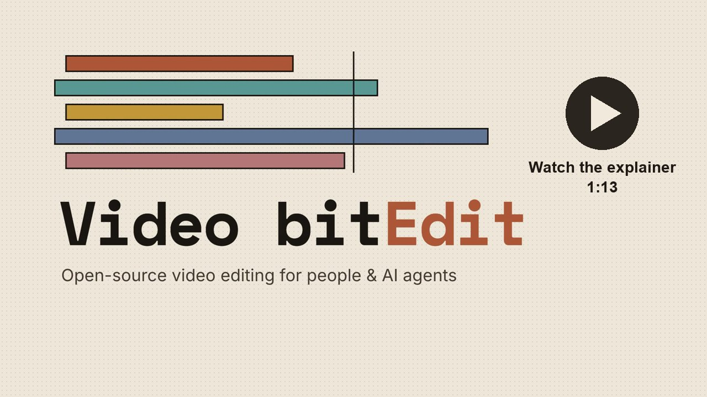
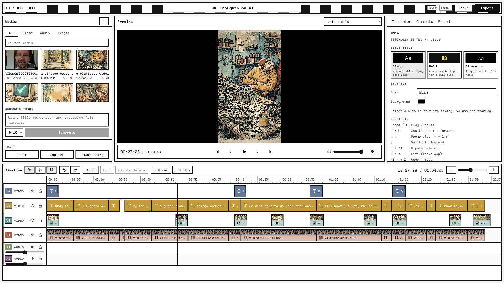
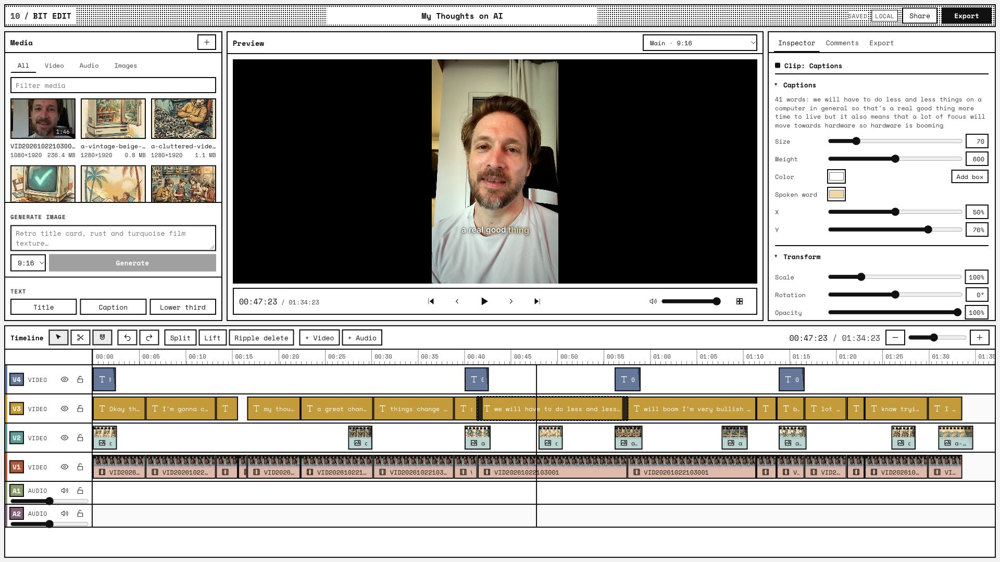
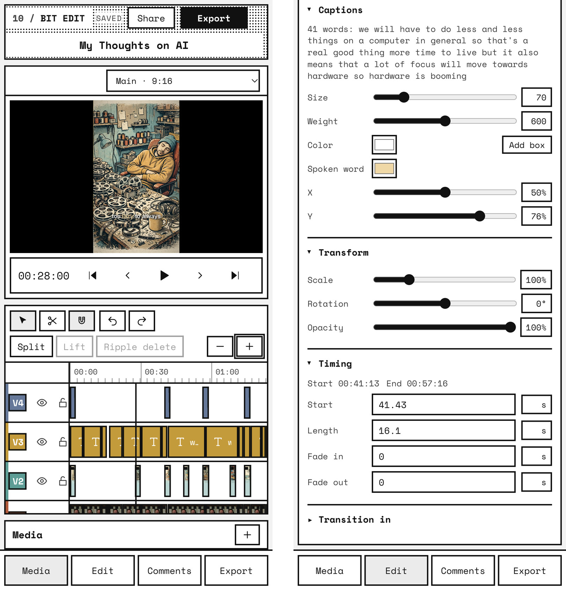
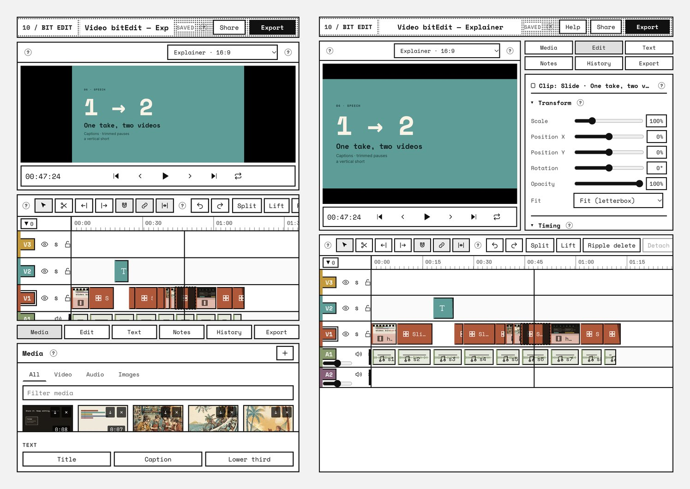
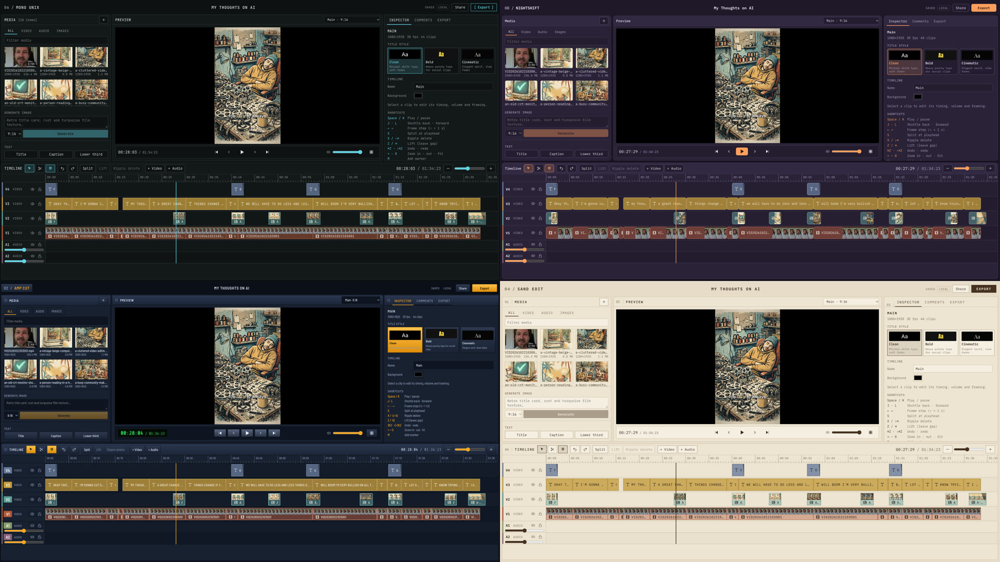
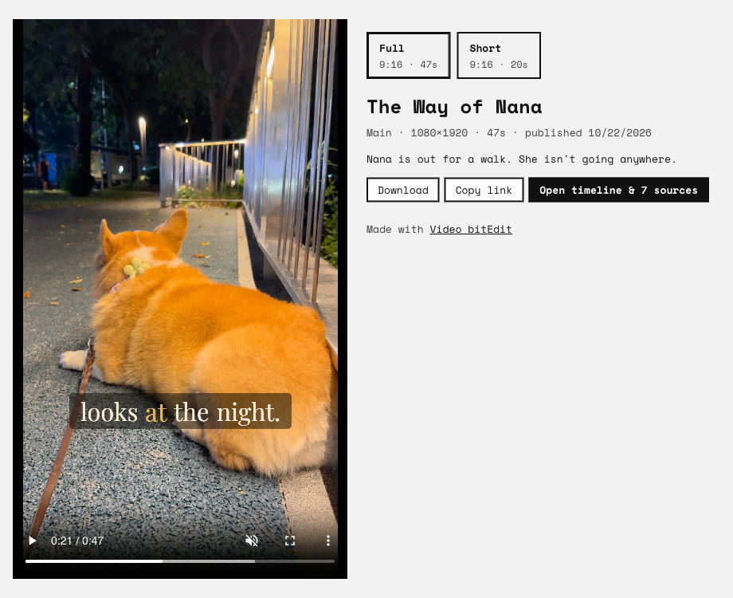

<div align="center">

# Video bitEdit

**Drop in a folder of clips. Get a finished film, a vertical short and a watch page.**<br>
An open-source video editor built for people *and* AI agents.

[](LICENSE)
[](https://www.remotion.dev)
[](https://workers.cloudflare.com)
[](docs/agents.md)

[Explainer video](https://www.youtube.com/watch?v=YY0tsgIJ2bo) · [Quick start](#quick-start) · [Keys](#keys) · [Let an agent cut it](#let-an-agent-cut-it) · [Share & publish](#share-and-publish) · [Docs](docs/README.md)

<a href="https://www.youtube.com/watch?v=YY0tsgIJ2bo"></a>

*The explainer above was cut in Video bitEdit itself.*



</div>

## How it works

1. **Point it at your footage.** `videdit open ./clips` turns any folder into a
   project. The timeline is a plain `videdit.json` next to your media, and
   nothing leaves your machine until you share it.
2. **Cut it, or let an agent cut it.** Edit in a multi-track timeline in the
   browser, or have an agent transcribe the speech and write a cut list in
   seconds. The open editor reloads live while the agent works.
3. **Ship it.** One Cloudflare API token puts the project on your own
   `*.workers.dev` URL. Collaborators get an edit link with every source clip,
   and viewers get a watch page that switches between the full movie and the
   short.

The preview and the final MP4 come from the same
[Remotion](https://www.remotion.dev) composition (headless Chrome + FFmpeg),
so what you see is what you export, frame for frame.

## A look around

### Captions that follow the voice



`videdit transcribe` runs Whisper on your machine and stores word timings next
to each clip. Caption clips show 3–4 words at a time, break at punctuation and
pauses, and light up the word being spoken in your title style's colour. Trim,
split or move the clips and the words stay in sync.

### Edit from your phone

<p align="center">
  
</p>

The whole editor is responsive. Scrub, trim, split and restyle captions on a
phone, with the media bin, inspector, comments and export one tab away.

### Coding Agent Optimized View



Most people review an agent's cut in a browser pane next to the coding agent,
which is a little wider than a phone. In panes 481–860 px wide and at least
600 px tall, the editor fits on one screen with no page scrolling. The header
is one line, the preview is compact, the timeline tools sit in one row, and
the timeline takes the free height. From 700 px the panels sit beside the
preview. In narrower panes they dock under the timeline, and clicking the
open tab folds the dock away to give the tracks more room.

### Five skins, one editor



Bit Edit (the default), Mono Unix, Nightshift, Amp Cut and Sand Edit. Click
the logo to switch.

### Watch pages with a Full / Short switcher

<p align="center">
  
</p>

**Render & publish** gives each timeline a public page with link previews.
Publish the full cut and the short, and viewers can switch between them.
**Unpublish** takes a page down again.
The film above was cut from six phone clips by an agent using the workflow
below.

## Features

**Timeline**
- Up to 10 video tracks and 8 audio tracks, with track colours from a retro
  muted palette.
- Move, trim, split (S or the razor tool), ripple delete (X) and lift (Z), all
  with snapping and undo/redo.
- Magnetic editing. The main-track magnet keeps V1 gapless: drops insert,
  moves reorder, and cuts close up. Linkage keeps captions and cutaways in
  sync. Drag media onto a clip to replace it at the same length, choosing
  which part of a longer clip plays. Desktop files can go straight onto the
  timeline. Box select, select backward and forward ([ ]), Q/W delete
  left/right, ⌘B split, and P/N/` toggle the magnet, snapping and linkage.
- J/K/L shuttle and frame stepping. ↑/↓ jump between cuts and markers, a
  click on the timecode takes a typed time (12.5, 1:05, +2), and ⌘-scroll or
  a pinch zooms around the pointer. Loop playback (⇧L) repeats the in/out
  range, the selected clips, or the whole timeline.
- An in/out range (I, O) with draggable, snapping ends: lift it (⇧Z),
  extract it (⇧X), play it once (⇧Space), loop it, or export just that part.
- Markers: point markers (M) and range markers (⌥M) in eight colours. Drag
  to move or resize, double-click to rename or delete, list them from the
  ruler, and copy them as YouTube chapters. They follow ripple edits on the
  main track.
- Clickable comment pins on the ruler jump to the comment.
- Copy, cut, paste at the playhead and duplicate (⌘C/X/V/D), ⌥⇧-drag to drag a
  copy, nudge by a frame (, . or ⌥←/→), turn clips off without deleting them
  (⇧E), and a right-click menu for all of it. Drags show the new position or
  length and a line where the clip snapped.
- Speed from 0.25× to 4×, freeze frames (⇧F), roll (⌥-drag a cut), slip
  (⌥-drag a clip), trim to the playhead (⌥[ ⌥]), and copy and paste a clip's
  look onto other clips (⌥⌘C, ⌥⌘V). Track headers rename, recolour,
  resize and reorder.
- Per-clip volume, fades, opacity, scale, position, rotation, and fit or fill
  cropping for reframing vertical shorts. Per-track volume, mute, solo, hide
  and lock. Solo is for listening: it changes what the preview plays, never
  the export.
- Fade knobs on each clip's top corners: drag them in to fade in or out.
- A volume line on audio clips: drag it up or down (⇧ for fine steps),
  double-click for 100%.
- Keyframes with easing for opacity, scale, position, rotation and volume:
  ◆ in the inspector (or ;) keys the value at the playhead, sliders auto-key
  once a property is animated, and each key picks linear, ease in, ease out,
  ease in-out or hold. The selected clip shows its keys as diamonds to drag
  or ⌥-click away. Trims, splits, speed changes and pasted looks keep the
  animation on the footage.
- Filmstrips along video clips (real frames for the part each clip plays),
  waveforms on audio clips and under video clips, and skimming: move the
  mouse across a video in the media bin to scrub through it.
- Edit by text: the Transcript tab shows the speech as paragraphs. Click a
  word to jump there, select a run and press ⌫ to cut it from every track;
  cut words stay visible, struck through, and come back with a click.
- A command palette (⌘K) for every command, marker, clip and help topic.
- Detach audio moves a video clip's sound to its own clip on an audio track,
  to trim, move and fade it separately.

**Look and sound**
- Text clips (title, caption, lower third) with three title styles and
  entrance animations.
- Effects that render identically in preview and export: auto color
  correction, grades (warm, teal & orange, vintage, noir…), film grain,
  vignette, light leaks, glitch, Ken Burns and zoom punch.
- Transitions: crossfade, dip to black or white, slide, whip pan, wipe, zoom.
- AI stills with an OpenRouter key (`meta/muse-image`), for title cards and
  cutaways, from the CLI, a cut list or the editor's Generate box.
- Exports are loudness-normalised to −14 LUFS, the level social platforms
  expect.
- Duck under speech: music dips by 6–24 dB wherever someone speaks on the
  other tracks (found from transcripts or the waveform), as volume keyframes
  you can adjust. Attack and release are adjustable, and Remove ducking takes
  it out again.
- Level meters on every audio track and a master meter, with a one-second
  peak hold and red above 0 dBFS. They read the waveform at the playhead
  with every volume, keyframe and fade applied, so they agree with the
  export. Normalize brings a clip's peak to −1 dBFS, and the volume shows in
  dB.

**Explainers**
- Remotion slides: title, bullets, split, image, stat and quote.
- HyperFrames HTML/GSAP compositions, rendered into clips.

**Short-form**
- Local word-timed transcription (whisper.cpp or OpenAI Whisper).
- Animated caption looks: classic, karaoke, pop, bounce, typewriter,
  highlight box and one word at a time, with words per line, a safe-area
  position and an accent colour. They render the same in preview and export.
- Cuts snapped to the quietest moment nearby, so words and breaths are not
  clipped.
- Several timelines share one media bin: a full cut in the footage's own shape
  and a 9:16 short derived from a highlight range.

**Nothing gets lost**
- Autosave, plus version history with one-click restore, kept locally and in
  the cloud.
- Crash-safe drafts in the browser, and a trash instead of hard deletes.

**Sharing**
- Edit links (collaborators) and view links (watch, scrub and comment), with
  timecoded comments.
- Workspace keys you can copy in one click. `videdit key` and unlock links
  (`…/#ws=KEY`) set up another browser or a render machine in one step.
- A render queue with MP4 (project size), 720p draft and MP3 presets, for
  the whole timeline, the in/out range or a range marker, plus PNG stills of
  the frame under the playhead.
- Public watch pages with link previews and a version switcher. A watch page
  links to the view-only timeline, so its source clips are public too.
- Uploads blank out phone GPS (QuickTime location atoms and JPEG EXIF), so
  shared clips do not reveal where they were shot.

**Help built in**
- A small ? next to every panel, section and dialog explains that part in a
  sentence or two.
- Help (or the ? key) opens a guide to every feature and keyboard shortcut,
  and lists every command in the ⌘K palette.

## Quick start

Requires Node 22+ and FFmpeg (`brew install ffmpeg`, or use the binaries
Remotion ships).

```bash
git clone https://github.com/veiovi/video-bitedit.git && cd video-bitedit
npm install
npm run build
node bin/videdit.mjs open ~/Movies/my-trip      # or: npm link, then `videdit open …`
```

The first render downloads Chrome Headless Shell (about 170 MB) for Remotion.

## Keys

Editing, transcription and rendering run on your machine and need no keys.
Two optional keys unlock the rest:

| Key | What it unlocks | How to set it |
|---|---|---|
| **Cloudflare API token** | Sharing and publishing. `videdit deploy` creates the D1 database, R2 bucket and Worker on your own account; after that you get `push`, edit and view links, the render queue and public watch pages. The token needs Workers Scripts, D1 and R2 edit permissions | `export CLOUDFLARE_API_TOKEN=…` before `videdit deploy` (it asks if the variable is not set) |
| **OpenRouter API key** | AI images: title cards and cutaways from `videdit generate`, `"generate"` clips in a cut list, and the editor's Generate box (default model `meta/muse-image`, about $0.01 a still) | `export OPENROUTER_API_KEY=…`, or save it once with `videdit config openrouter-key`. Add `--with-openrouter` to `videdit deploy` so cloud editors can generate images too |

The Cloudflare token is only read while `deploy` runs and is never saved. A
saved OpenRouter key lives in `~/.config/videdit/config.json` (mode 600), and
with `--with-openrouter` also as a secret on your own Worker.

## Let an agent cut it

The CLI is built for agents: list the footage, read the transcript, write a cut
list in seconds, and review the result in the editor.

```bash
videdit info ~/Movies/my-trip          # asset names, IDs, durations and sizes
videdit transcribe ~/Movies/my-trip    # word timings, needed for "captions"
videdit cut ~/Movies/my-trip plan.json # builds the timelines
videdit render ~/Movies/my-trip --timeline Short
```

```json
{
  "title": "The Long Way Home",
  "theme": "cinematic",
  "trackVolume": { "A2": 0.6 },
  "timelines": [
    {
      "name": "Main",
      "clips": [
        { "asset": "coast_01", "in": 0.5, "out": 6.5, "fadeIn": 0.5 },
        { "asset": "road_02", "in": 1, "out": 5, "volume": 0.4 },
        { "text": "The Long Way Home", "track": "V2", "at": 1, "duration": 3 },
        { "asset": "music_theme", "track": "A2", "at": 0, "duration": 16, "fadeOut": 2 }
      ],
      "captions": "auto"
    },
    { "name": "Short", "from": "Main", "range": [4, 14], "captions": "auto" }
  ]
}
```

`Main` keeps the footage's own shape, and `Short` becomes a 9:16 crop of
seconds 4–14. See [docs/agents.md](docs/agents.md) for the full format: effects,
transitions, AI stills, captions and snapping. There is also a ready-made agent
skill in [skills/videdit](skills/videdit/SKILL.md).

## Share and publish

```bash
export CLOUDFLARE_API_TOKEN=…   # Workers Scripts, D1 and R2 edit permissions
videdit deploy                  # once: creates D1 + R2, deploys the Worker
videdit push ~/Movies/my-trip   # prints an edit link and a view link
videdit worker                  # renders jobs queued from the web editor
videdit pull ~/Movies/my-trip   # bring cloud edits back to your folder
videdit publish ~/Movies/my-trip --timeline Main   # render here and publish
```

`deploy` saves the server URL and a generated workspace key to
`~/.config/videdit/config.json` (mode 600). The workspace key creates projects
and authorizes render workers. Each project's edit key is kept in the URL
fragment of its edit link, so it is never sent in server logs.

Rendering does not run on Cloudflare. **Render** and **Render & publish** in
the web editor queue a job, and any machine running `videdit worker` with your
config picks it up. Published renders appear at `/w/<id>`, with link-preview
metadata and a link back to the timeline and its sources.

## Architecture

```
Browser editor (React + Remotion Player) ──/api, /m──▶ Cloudflare Worker ──▶ D1 (projects, renders, comments)
        ▲                                                   │                └▶ R2 (sources, thumbnails, transcripts, renders)
        │ same REST API                                     │ render queue
Local server (videdit open) ◀── project folder              ▼
                                                     videdit worker (Remotion + FFmpeg) ── uploads result
```

- `src/shared` holds the timeline model, the pure edit operations, captions
  and the title styles.
- `src/remotion` holds the composition that both the preview and the renderer
  use.
- `src/web` is the editor, the home page and the watch page.
- `src/worker` is the Cloudflare Worker (D1 + R2).
- `src/node` holds the CLI, the local server, transcription, rendering, cloud
  push/pull and deploy.

More detail is in [docs/](docs/README.md).

## Development

```bash
npm run test        # unit tests (edit operations, cut lists, captions, effects)
npm run typecheck
npm run dev         # web app + Worker with local D1/R2 (needs wrangler.jsonc; copy wrangler.example.jsonc)
npm run db:migrate:local
```

## License

MIT, see [LICENSE](LICENSE).

Video bitEdit depends on [Remotion](https://www.remotion.dev), which has its own
license. It is free for individuals and for companies of up to 3 people;
larger companies need a [Remotion company license](https://www.remotion.pro/license).
